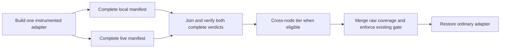

# Overlapping the complete Brine integration tiers

The candidate reduced the Brine task script from **34m08s to 27m35s** in a matched CI pair: **6m33s (19.2%) less elapsed time**. Both runs passed the same **1,050 real scenarios**, **5,687 steps**, and complete recorder drains, including the cross-node tier.

The changes are limited to test scheduling, result collection, and launcher cleanup. No feature, assertion, fixture implementation, production timeout, polling interval or test data was replaced or weakened. All 291 feature and non-test step implementation files match core byte-for-byte. Production Go code is unchanged.

Benchmark base: `core` / `1d0e377594898bff615f1c222f9977e0ea094acc`, fetched before the experiment and confirmed still current on the remote after the paired runs. This is one pair on a shared cluster, not a latency distribution or a measured whole-pipeline speedup. The implementation was subsequently rebased onto `ebb2ec280104c572b0fee40282316803634c85ca` for delivery; the measurements below remain tied to the benchmark source. No installed pipeline configuration was changed during the experiment.

## Measured result

| Measurement | Sequential | Concurrent |
|---|---:|---:|
| Preparation through first manifest start | 2m58s | 2m54s |
| Local manifest, 918 scenarios | 437.220s | 438.557s |
| Live manifest, 131 scenarios | 1372.874s | 1421.155s |
| Elapsed span containing both mandatory manifests | 30m10s | 23m41s |
| Actual overlap between mandatory manifests | 0m00s | 7m19s |
| Cross-node manifest, 1 scenario | 49.513s | 50.158s |
| Whole task script, including setup and final restoration | **34m08s** | **27m35s** |

The concurrent run hides 7m19s of local work inside the live run. The mandatory-manifest elapsed span falls by 6m29s. Differences in the durations of individual live operations and preparation also contribute to the observed whole-task difference; they must not all be attributed to overlap.

The live manifest was 48.281s longer concurrently. The largest individual difference was the real scratch-volume eviction step: 73.604s concurrently versus 15.004s sequentially (+58.600s), partly offset by other live steps. The local manifest differed by only 1.337s. These are observed timing differences, not proof of a resource-contention cause. [All step differences](../../output/brine-overlap-20261103/step-timing-differences.json) are retained.

Numeric manifest durations come from protocol timers. Phase boundaries and script receipts have one-second precision. The task finish receipt is written after coverage verification and restoration of the ordinary adapter, before the 45-second evidence-export hold. That hold is excluded from both task durations.

CI evidence: [concurrent build 1144620](https://concourse.home/builds/1144620), [sequential build 1144719](https://concourse.home/builds/1144719). Both use the same frozen 3,010-file source snapshot, `k3s-agent-y`, a one-CPU request without CPU/memory limits, Go 1.25.14, PostgreSQL 17.11, and runner digest `sha256:1e1fa432a1d399400bdc140452f610bd4efab8259eb989df2dfb0ea32fdb8fe3`.

The task configurations match after excluding the schedule switch and evidence collection wrapper. The runs were consecutive, with all observed owned namespaces removed between them. Pipeline-bound one-off tasks use the existing CI credential context. These one-offs do not themselves acquire the installed job’s serial groups; no other heavy profiling jobs were started alongside them. The installed job and its exclusion locks are unchanged.

## Implementation

- [`scripts/coverage`](../../atc/worker/jetbridge/brine/scripts/coverage) launches two complete CLI runs in separate process groups. Local work retains its private network namespace; live work retains the real cluster route. Each run writes its own raw coverage and log. Both are joined before restoration; either nonzero CLI verdict fails the task. An ordinary failure does not abort the sibling’s scenarios or disposal.
- The local manifest moved to [`local/.brine`](../../atc/worker/jetbridge/brine/local/.brine), with relative paths adjusted. The pinned CLI selects directories rather than a single manifest, so leaving the local manifest at the parent would also discover live tests. Plain `brine run` from the module root still discovers both tiers.
- The real-CLI [inventory guard](../../atc/worker/jetbridge/brine/cmd/brine-verify-run/selection_test.go) proves that local/live selection exactly partitions default discovery, including files, expanded scenario inventory and budgets. An extra discoverable tier was injected into a disposable copy; the guard correctly failed. Each tier’s completed log is independently checked against its full manifest floor.
- Cross-node eligibility, its real test, the production package coverage denominator and the 50% minimum stay unchanged. `go tool covdata merge` combines the three raw directories after successful verdicts. `BRINE_COVERAGE_SCHEDULE=serial sh scripts/coverage` provides a matched sequential mode and scheduling rollback.

## Coverage and test preservation

| Evidence | Sequential | Concurrent |
|---|---:|---:|
| Passed scenarios | 1,050 | 1,050 |
| Passed steps | 5,687 | 5,687 |
| Complete, non-partial drains | 1,050 | 1,050 |
| Covered / total production statements | 2,846/3,593 | 2,846/3,593 |
| Production statement coverage | 79.209574% | 79.209574% |

The offline verifier compares scenario and step identity multisets, not just their counts. Both also match the original unchanged-core profiling build 1142537: no original executed scenario or step disappeared. It also compares every coverage block and statement count. A separate covdata check proves every merged execution counter equals the sum of the raw local, live and cross-node counters.

Coverage block-set differences: 0 covered only concurrently; 0 covered only sequentially. The block denominator is identical. Dynamic branch coverage can vary between real executions; detailed block differences are retained in `comparison.json`.

## Resource cost and remaining elapsed time

| Task-cgroup measurement | Sequential | Concurrent |
|---|---:|---:|
| Sampled mandatory-tier span, seconds | 1801.0 | 1415.8 |
| CPU-seconds during that span | 327.736 | 330.159 |
| Mean task cores | 0.182 | 0.233 |
| Maximum sampled memory during that span, GiB | 4.502 | 4.750 |
| CPU throttled periods | 0 | 0 |
| Task lifetime peak memory including preparation, GiB | 5.709 | 5.577 |

Samples are about five seconds apart and are bounded inside the manifest interval. Memory includes cache and is not process RSS. The task cgroup includes local child processes but excludes external live pods and the cluster control plane. Low driver CPU therefore does not imply an idle cluster. Parallel tier windows overlap and must not be summed.

Concurrent-run timing below uses non-overlapping categories within each tier. The tiers themselves overlap.

| Tier | Step bodies | Recorder drain | Other inside scenarios | Scope / runner residual | Total |
|---|---:|---:|---:|---:|---:|
| local | 357.428s | 3.539s | 1.496s | 76.094s | 438.557s |
| live | 1299.373s | 99.027s | 0.160s | 22.595s | 1421.155s |
| multinode | 35.173s | 8.432s | 0.001s | 6.552s | 50.158s |

The remaining critical path is the live tier. Its largest measured step costs are:

| Real step | Calls | Sequential total | Concurrent total |
|---|---:|---:|---:|
| the pod finishes before its watched history expires | 1 | 94.391s | 94.424s |
| the next step fetches the artifact from that node | 5 | 79.624s | 78.855s |
| the kubelet evicts a pod that exceeds its scratch volume limit | 1 | 15.004s | 73.604s |
| an artifact daemon on a real node | 8 | 67.385s | 68.066s |
| the pause pod stops "on the first dial" from "Evicted" before the task can execute | 1 | 53.258s | 64.226s |
| the pause pod stops "before startup" from "Evicted" before the task can execute | 1 | 72.417s | 61.404s |
| the pause pod stops "before startup" from "Evicted then TERM" before the task can execute | 1 | 62.627s | 52.688s |

These are elapsed step bodies, including fixture acquisition performed inside them. They are not isolated product-operation CPU costs. The real watch-history expiration, scratch-volume eviction and cancellation-period tests remain unchanged. The next bounded experiment is to measure eviction on an isolated node with a shorter volume-statistics cadence while retaining the actual kubelet eviction/status/event assertions. This change does not alter node settings or claim that shortening that cadence has already been validated.

## Validation and operational behavior

- Both full CI runs retain the standard binary builds, vet, native Ginkgo suites, all integration manifests, per-manifest budgets, coverage gate and cleanup. Local chart tests and pipeline validation pass.
- Standards and specification review passes found no actionable findings. Linux preflight caught a shell portability issue in the new launcher: dash’s builtin `kill` does not accept this negative-process-group syntax with `--`. The launcher uses `/bin/kill`; the corrected Linux probe passed.
- [Cancellation build 1144866](https://concourse.home/builds/1144866) sent two TERM signals to the actual concurrent coverage script after both real adapters exercised steps. It returned the expected signal exit 143, left no Brine/database/API-server fixture process, restored the non-instrumented adapter and verified removal of the cancelled run’s owned live namespaces. This supplemental interruption probe is separate from the two complete-suite passes.
- The first interruption probe waited on namespace diagnostics buffered by the CLI. A manual TERM released those diagnostics and the harness sent another TERM; build 1144840 failed the adapter-restoration check. This exposed the repeated-signal edge case above. The corrected probe waits on a completed real transfer step and deliberately repeats TERM. The unsuccessful attempt and its logs are retained.
- Successful-run cleanup was also checked between runs and after the pair. The pre-existing unrelated `brine-runtime-2s65l` namespace was left untouched. No installed pipeline or production cluster timing configuration was changed.

## Reproduction and retained evidence

All new evidence is under [`output/brine-overlap-20261103`](../../output/brine-overlap-20261103/README.md). The `parallel-evidence.tar.gz` and `serial-evidence.tar.gz` archives contain raw protocol logs, raw coverage per tier, merged coverage, and start/finish/verdict receipts. The cancellation archive contains its real-fixture probe logs and cleanup receipts.

- [Comparison](../../output/brine-overlap-20261103/comparison.json), [environment parity](../../output/brine-overlap-20261103/paired-environment-verification.json), [test-source parity](../../output/brine-overlap-20261103/test-substance-parity.json).
- [Concurrent profile](../../output/brine-overlap-20261103/parallel-profile.json) and [sequential profile](../../output/brine-overlap-20261103/serial-profile.json), including feature and step rankings.
- [Analysis script](../../output/brine-overlap-20261103/analyze.py), [resource/timing parser](../../output/brine-overlap-20261103/profile.py), and [independent coverage union verifier](../../output/brine-overlap-20261103/verify_coverage_union.py).
- Exact task configurations, pod/image/resource receipts, source hashes, complete CI logs, candidate patch and collection caveats are retained alongside them. After the paired timing runs, a real interruption probe exposed that repeated TERM could interrupt cleanup before ordinary-adapter restoration completed. The final patch ignores further INT/TERM/HUP during cleanup; its changed cancellation path was validated with two TERM signals against real fixtures. The paired source, final source hashes, both patches and the small post-pair cleanup diff are retained. Scheduling, selection and all test bodies are unchanged between those snapshots. Evidence collection required a symlink repair in the first disposable input and a collector restart; neither changed test execution. Subsequent collection uses the corrected wrapper.

Run `python3 analyze.py parallel serial` after extracting the evidence archives into their label directories, then `python3 profile.py parallel serial`. The coverage union verifier uses `go tool covdata`; on toolchains that omit its prebuilt executable, build `cmd/covdata` with the installed Go toolchain and set `COVDATA=/path/to/covdata`.
