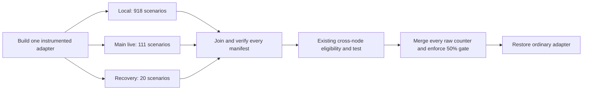

# Overlapping complete real recovery scenarios

The candidate reduced the full Brine task script from **26m50s
to 21m25s**, saving **5m24s
(20.1%)** in a matched CI pair. Both runs passed
**1,050 scenarios and 5,687 steps**, including the real cross-node test.

The change moves two complete feature files into a recovery manifest that runs
alongside the local and remaining live manifests. Their real eviction, OOM,
sidecar and replacement behavior is unchanged. No test body, assertion, fixture
implementation, timeout, resource limit or shared-node kubelet setting changed.
Production Go code is unchanged.

Benchmark base: core `28a0e8d391ff196ab295cc393386994d1d00e50a`.
[Baseline build 1152598](https://concourse.home/builds/1152598) already
overlaps local and live work, as shipped in the previous optimization.
[Candidate build 1152699](https://concourse.home/builds/1152699) adds the
recovery group. Both use `BRINE_COVERAGE_SCHEDULE=parallel`; this comparison does
not count the previous local/live overlap gain again. This is one consecutive
pair on a shared cluster, not a latency distribution or measured whole-pipeline saving.

## Measured time

| Phase or manifest | Baseline: two groups | Candidate: three groups |
|---|---|---|
| Task script, including build/checks and restoration | 1,609.703s | 1,285.488s |
| Preparation through first integration start | 174.078s | 174.098s |
| Mandatory integration wall time | 1,376.000s | 1,050.000s |
| Local manifest | 438.467s | 440.741s |
| Main live manifest | 1,375.328s | 1,050.179s |
| Separate recovery manifest | Included in live | 347.491s |
| Cross-node manifest | 49.090s | 50.089s |

Manifest rows overlap and must not be summed. Numeric manifest durations are
protocol timers; start/end event timestamps have one-second precision. Script
and phase receipts have subsecond timestamps. Script finish follows coverage
verification and restoration of the ordinary adapter, before the 45-second
collection hold. That hold is excluded from both measurements.

The moved scenarios accounted for **343.417s**
of baseline scenario time, including recorder disposal. Their candidate scenario
time was 339.402s. The common live scenarios
changed by +19.858s in aggregate; ordinary
real-cluster variation and extra suite setup also affect the measured saving.
[Every observed step difference](../../output/brine-recovery-20261105/step-timing-differences.json)
is retained rather than attributing all timing differences to scheduling.

The preceding [eviction investigation](ci-eviction-profiles-2026-11-05.md)
identified kubelet volume accounting as the dominant delay. A shorter cadence
helped on disposable nodes, but this implementation keeps the existing
one-minute shared-node setting and overlaps the complete real work.

## Implementation and test preservation

- [`scripts/coverage`](../../atc/worker/jetbridge/brine/scripts/coverage) launches
  three CLI/adapter process groups, each with its own log and raw coverage
  directory. Every group is joined even if another returns an ordinary failure.
  Each complete manifest must pass its CLI verdict and strict verifier.
- The existing live manifest moves to
  [`live/main/.brine`](../../atc/worker/jetbridge/brine/live/main/.brine).
  [`live/recovery/.brine`](../../atc/worker/jetbridge/brine/live/recovery/.brine)
  selects the unchanged compatibility-process and container-lifecycle files.
  Their original floor of 131 partitions into 111 + 20; the local floor remains
  918. Plain `brine run live` still discovers every live scenario.
- Recovery does not use the artifact-daemon host port. PostgreSQL servers own
  atomically reserved ports; databases, live namespaces and permission changes
  retain their existing per-scenario ownership. Artifact-port users remain in
  the main group. Cross-node work still follows all mandatory groups.
- The real-CLI inventory guard proves nonempty, disjoint manifest selection,
  budgets and exact union with root discovery. Vocabulary checks reuse the
  existing nonempty recursive feature scan, including the moved files.
- All **108 feature files** and
  **182 non-test Go step files** retain
  identical filename/content multisets. Among these files, only the two feature
  locations change.
  Execution-source hashes match the frozen candidate; later report/index edits
  are documented separately. Pipeline task settings and exclusion locks are unchanged.

| Verification | Baseline | Candidate |
|---|---|---|
| Passed scenarios | 1050 | 1050 |
| Passed steps | 5687 | 5687 |
| Complete, non-partial drains | 1050 | 1050 |
| Covered / total production statements | 2861/3612 | 2861/3612 |
| Production statement coverage | 79.208195% | 79.208195% |

The analyzer compares scenario and step **identity multisets**, not merely counts.
It also verifies identical production coverage block denominators. Independently,
`covdata` replay proves each merged execution counter equals the sum of every
raw tier's counters, including recovery and cross-node.

Covered block differences: 0 candidate-only,
0 baseline-only. Real execution can take
slightly different branches; the full lists are retained in
[comparison.json](../../output/brine-recovery-20261105/comparison.json).

## Resources and remaining elapsed time

| Mandatory-window task cgroup | Baseline | Candidate |
|---|---|---|
| CPU-seconds | 334.049 | 335.855 |
| Mean task cores | 0.244 | 0.321 |
| Maximum sampled memory, GiB | 4.801 | 4.893 |
| CPU-throttled periods | 0 | 0 |

Five-second samples are bounded inside the mandatory integration window and
exclude its edges. Task CPU includes adapter and local fixture processes, but
excludes external live pods and the shared control plane. Memory includes page
cache. Concurrent manifest resource windows must not be added.

Candidate time within each manifest:

| Manifest | Step bodies | Recorder drain | Other fixture/runner time | Total |
|---|---|---|---|---|
| local | 359.544s | 3.926s | 77.271s | 440.741s |
| live | 933.515s | 95.515s | 21.149s | 1,050.179s |
| recovery | 334.013s | 5.379s | 8.099s | 347.491s |
| multinode | 35.556s | 7.969s | 6.564s | 50.089s |

The remaining critical path is the main live manifest, at
17m30s, while recovery finishes in
5m47s. The next investigation is balancing
additional independent live feature files after auditing their port and fixture
ownership. Real timeout and watch-expiration assertions should retain their
conditions. Per-feature and slow-step rankings are in the
[candidate profile](../../output/brine-recovery-20261105/candidate-profile.json).

## Validation, cleanup and reproducibility

Both complete CI runs include the actual pipeline builds, vet, native suites,
integration manifests, cross-node test, independent manifest verification and
production coverage gate. Local guard tests, real CLI inventory, shell syntax
and pipeline validation also passed.

[Cancellation build 1152776](https://concourse.home/builds/1152776)
sent two TERM signals to the real coverage launcher after all three adapters
performed real steps. It returned the expected exit 143, disposed the fixture
processes, restored the non-instrumented adapter and verified removal of owned
live namespaces. This interruption probe is supplemental, not a full-suite pass.

Baseline namespaces were checked before candidate integration began. Final
cleanup verified all observed owned namespaces removed; the pre-existing
`brine-runtime-2s65l` namespace was left untouched. One-off tasks use the existing
pipeline credential context but do not acquire its serial groups. Conflicting
automatic work was checked before each launch and active CI pods were sampled
throughout. Neither measured run had another CI build pod in those 30-second
samples; short work between samples can be missed. The installed pipeline and
shared-node configuration were not edited.

Both measured runs used `k3s-agent-y`, Go 1.25.14, PostgreSQL 17.11,
runner digest `sha256:1e1fa432a1d399400bdc140452f610bd4efab8259eb989df2dfb0ea32fdb8fe3`,
4 CPU / 12GB requests and no task CPU or memory limits. Both shared nodes remained
on Kubernetes v1.34.3+k3s1 with a one-minute volume-statistics period.

The [evidence directory](../../output/brine-recovery-20261105/README.md) contains
raw protocol logs and coverage, phase receipts, cgroup samples, image/resource
receipts, frozen source hashes, the complete candidate patch, analyzers and the
repeated-signal probe. `evidence-bundle.tar.gz` and its checksums support replay.
These `output/` artifacts are local and untracked. The report and implementation
are repository changes ready for review.
