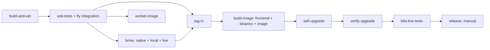
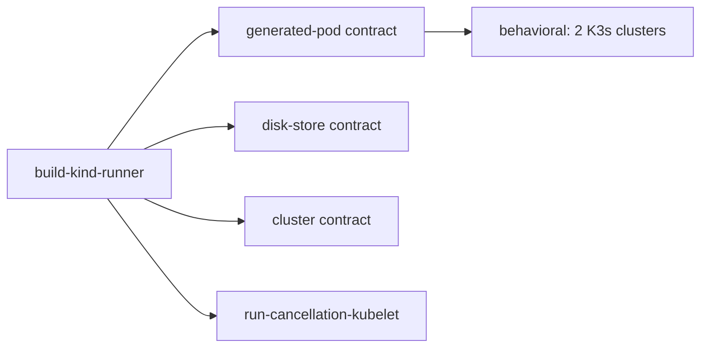

# CI test-suite structure and profiling opportunities

Source inspected: `core` at `1d0e377594898bff615f1c222f9977e0ea094acc`.
This is a source audit, not a timing measurement. It maps the checked-in
pipeline definitions. The installed definitions captured in
`output/ci-performance-20261102/live-jetbridge-pipeline.yml` and
`live-k8s-e2e-pipeline.yml` were parsed and compared recursively by job name.
Every job, command, parameter, dependency, serial group and CPU request matches.
The only differences are serialization: an omitted `trigger: false` on release,
and `18GB` represented as `19327352832` bytes. Selected resource version, node,
image digest and actual build records must still accompany measurements.
Historical numbers in comments and earlier reports are explicitly identified
below and must not be substituted for current measurements.

## Findings that affect the critical path

1. **Brine serializes much more than its live work.** Its entire task holds the
   groups shared by build-and-vet, unit-tests, worker-image and the live tier.
   That includes compilation, native adapter tests and local scenarios. It
   blocks early feedback for later commits as well as the release chain.
   This is intentional protection against previously observed live-tier
   interference, so isolation must precede removing the groups.
   [deploy/concourse-pipeline.yml:19](https://github.com/tdmtrader/jetbridge/blob/1d0e377594898bff615f1c222f9977e0ea094acc/deploy/concourse-pipeline.yml#L19),
   [deploy/concourse-pipeline.yml:178](https://github.com/tdmtrader/jetbridge/blob/1d0e377594898bff615f1c222f9977e0ea094acc/deploy/concourse-pipeline.yml#L178)
2. **The unit job's resource request and test fan-out describe different budgets.**
   It requests six CPUs, but reads the whole node's `nproc`. On a 28-core node
   it starts eight Ginkgo suites at four processes each, plus an unrestricted
   `go test` for the rest. On a node below 24 CPUs, those heavy suites run one
   after another. Wall time is therefore highly dependent on node placement
   and concurrent work; increasing parallelism is not automatically faster.
   [hack/unit-tests.sh:90](https://github.com/tdmtrader/jetbridge/blob/1d0e377594898bff615f1c222f9977e0ea094acc/hack/unit-tests.sh#L90),
   [hack/unit-tests.sh:110](https://github.com/tdmtrader/jetbridge/blob/1d0e377594898bff615f1c222f9977e0ea094acc/hack/unit-tests.sh#L110)
3. **The E2E toolchain image is rebuilt without Docker cache on every source
   trigger and daily timer.** The task clones moving `core` again instead of
   using its selected input and pushes the same `v35` tag to two registries.
   The tests use their fresh repo input, but the toolchain image can be old on
   a node using `PullIfNotPresent`. This is both repeated setup work and a
   reproducibility problem. The runner Dockerfile also installs Ginkgo
   `@latest` and the latest stable kubectl.
   [deploy/k8s-e2e-pipeline.yml:23](https://github.com/tdmtrader/jetbridge/blob/1d0e377594898bff615f1c222f9977e0ea094acc/deploy/k8s-e2e-pipeline.yml#L23),
   [deploy/k8s-e2e-pipeline.yml:103](https://github.com/tdmtrader/jetbridge/blob/1d0e377594898bff615f1c222f9977e0ea094acc/deploy/k8s-e2e-pipeline.yml#L103),
   [deploy/Dockerfile.kind-runner:16](https://github.com/tdmtrader/jetbridge/blob/1d0e377594898bff615f1c222f9977e0ea094acc/deploy/Dockerfile.kind-runner#L16)
4. **The standard CI commands do not produce a durable performance dataset.**
   Unit tests provide package elapsed times and Ginkgo console summaries;
   heavy-suite logs are printed only after the foreground Go command ends.
   Brine writes structured events and Go statement coverage into a temporary
   directory inside the task. Neither test job declares an output holding
   those files. There is no CPU, heap, block, mutex or execution-trace capture
   in these invocations. Statement coverage is not a performance profile.
   [hack/unit-tests.sh:129](https://github.com/tdmtrader/jetbridge/blob/1d0e377594898bff615f1c222f9977e0ea094acc/hack/unit-tests.sh#L129),
   [atc/worker/jetbridge/brine/scripts/coverage:42](https://github.com/tdmtrader/jetbridge/blob/1d0e377594898bff615f1c222f9977e0ea094acc/atc/worker/jetbridge/brine/scripts/coverage#L42)

## Main pipeline

All source gets below trigger automatically except the final release. A
`passed` dependency matches source versions; it does not account for queueing,
pod admission, image pulls or retries.

| Job | Actual selection/work | Timeout / attempts | Explicit CPU request | Source |
|---|---|---|---|---|
| build-and-vet | Build concourse and artifact-daemon; vet selected package trees; vet runtime with `live` and `hangar_live` tags | 20m / 2 | 6000m | [pipeline:47](https://github.com/tdmtrader/jetbridge/blob/1d0e377594898bff615f1c222f9977e0ea094acc/deploy/concourse-pipeline.yml#L47) |
| unit-tests | Shared unit script, followed by fly integration | 45m / 2 | 6000m | [pipeline:97](https://github.com/tdmtrader/jetbridge/blob/1d0e377594898bff615f1c222f9977e0ea094acc/deploy/concourse-pipeline.yml#L97) |
| brine | Private-network build, vet nested module, all native nested-module suites, static live artifact daemon, instrumented local + live Brine and optional cross-node tier | 120m / 2 | None; deployment default applies | [pipeline:178](https://github.com/tdmtrader/jetbridge/blob/1d0e377594898bff615f1c222f9977e0ea094acc/deploy/concourse-pipeline.yml#L178) |
| worker-image | Build production worker and Git variant; compile and run session, implement and review tests inside the images | 60m / 1 | None | [pipeline:288](https://github.com/tdmtrader/jetbridge/blob/1d0e377594898bff615f1c222f9977e0ea094acc/deploy/concourse-pipeline.yml#L288), [script:39](https://github.com/tdmtrader/jetbridge/blob/1d0e377594898bff615f1c222f9977e0ea094acc/hack/build-worker-image#L39) |
| tag-rc | Validate version and create task-local tag | 10m / 2 | None | [pipeline:321](https://github.com/tdmtrader/jetbridge/blob/1d0e377594898bff615f1c222f9977e0ea094acc/deploy/concourse-pipeline.yml#L321) |
| build-image | Build frontend, then binaries/image | 20m / 2 frontend; 45m / 2 image | 6000m image | [pipeline:369](https://github.com/tdmtrader/jetbridge/blob/1d0e377594898bff615f1c222f9977e0ea094acc/deploy/concourse-pipeline.yml#L369) |
| self-upgrade | Change running deployment | 10m / 2 | None | [pipeline:749](https://github.com/tdmtrader/jetbridge/blob/1d0e377594898bff615f1c222f9977e0ea094acc/deploy/concourse-pipeline.yml#L749) |
| verify-upgrade | Rollout, image identity and API checks; unconditional 15s endpoint-settle sleep | 25m / 2 | None | [pipeline:813](https://github.com/tdmtrader/jetbridge/blob/1d0e377594898bff615f1c222f9977e0ea094acc/deploy/concourse-pipeline.yml#L813), [pipeline:929](https://github.com/tdmtrader/jetbridge/blob/1d0e377594898bff615f1c222f9977e0ea094acc/deploy/concourse-pipeline.yml#L929) |
| k8s-live-tests | `go test -tags live -v -count=1 -timeout 15m ./atc/worker/jetbridge/...` | 45m / 2 | 6000m | [pipeline:966](https://github.com/tdmtrader/jetbridge/blob/1d0e377594898bff615f1c222f9977e0ea094acc/deploy/concourse-pipeline.yml#L966) |

The automatic path to live validation is additive through all jobs in the
diagram except worker-image. Worker-image is not a release prerequisite, but
it competes for Brine's serial groups and self-upgrade also waits for its group.
Brine and self-upgrade can therefore lengthen latency for a different commit.
The release jobs share `deploy`; Brine and k8s-live-tests share `live-tier`.
Task timeout includes pending pod scheduling, as the pipeline's header states.
Retries can double the entire task cost, including successful work before the
failure. [pipeline:31](https://github.com/tdmtrader/jetbridge/blob/1d0e377594898bff615f1c222f9977e0ea094acc/deploy/concourse-pipeline.yml#L31),
[pipeline:750](https://github.com/tdmtrader/jetbridge/blob/1d0e377594898bff615f1c222f9977e0ea094acc/deploy/concourse-pipeline.yml#L750)

The checked-in core pipeline has only the frontend's explicit task caches
(`yarn-global` and `elm-home`). Go test jobs have no task-level Go build cache.
The test-runner Dockerfile downloads public root-module dependencies, but does
not warm root compilation or private Brine module source. A new task can thus
reuse baked module downloads while still compiling anew.
[pipeline:398](https://github.com/tdmtrader/jetbridge/blob/1d0e377594898bff615f1c222f9977e0ea094acc/deploy/concourse-pipeline.yml#L398),
[deploy/Dockerfile.test-runner:122](https://github.com/tdmtrader/jetbridge/blob/1d0e377594898bff615f1c222f9977e0ea094acc/deploy/Dockerfile.test-runner#L122)

### Unit selection and duplicated execution

The unit script selects all packages from `go list ./...`, excluding `topgun`,
`fly/integration`, `testhelpers/otel`, and the nested Brine module. It divides
eight exact packages into heavy suites: `atc/db`, `atc/api`, `atc/db/migration`,
`atc/exec`, `atc/scheduler/algorithm`, `atc/engine`, `atc/runs`, and
`atc/worker/jetbridge`. Everything else runs with plain `go test -count=1`.
The pipeline does not set `UNIT_PACKAGES`; that narrowing is for affected-package
ad hoc checks. [hack/unit-tests.sh:37](https://github.com/tdmtrader/jetbridge/blob/1d0e377594898bff615f1c222f9977e0ea094acc/hack/unit-tests.sh#L37),
[hack/unit-tests.sh:84](https://github.com/tdmtrader/jetbridge/blob/1d0e377594898bff615f1c222f9977e0ea094acc/hack/unit-tests.sh#L84)

Mixed packages have an important multiplier: each Ginkgo worker executes the
whole Go test binary, so ordinary `TestXxx` functions run once per worker,
although Ginkgo specs are distributed. The script explicitly documents this.
Profile ordinary tests separately before interpreting an aggregate heavy-suite
total or moving another mixed package into that list.
[hack/unit-tests.sh:90](https://github.com/tdmtrader/jetbridge/blob/1d0e377594898bff615f1c222f9977e0ea094acc/hack/unit-tests.sh#L90)

Fly integration then starts another parallel Ginkgo invocation and builds fly.
Worker-image intentionally repeats three agent packages under the production
image. The live job's build tag adds tests; it does not exclude the untagged
runtime unit suites. This repeated work has different purposes and should be
reported explicitly before any selection is changed.
[Makefile:29](https://github.com/tdmtrader/jetbridge/blob/1d0e377594898bff615f1c222f9977e0ea094acc/Makefile#L29),
[pipeline:1062](https://github.com/tdmtrader/jetbridge/blob/1d0e377594898bff615f1c222f9977e0ea094acc/deploy/concourse-pipeline.yml#L1062)

### Brine phases and coverage

The task's private-network builder compiles the launcher, adapter and root-module
artifact daemon. After vet and native suites it separately builds a static live
daemon. The coverage script runs guards, calls the private-network builder
again, builds an atomic-coverage adapter, runs Brine, verifies scenario counts,
optionally runs the cross-node tier, converts coverage, checks the unchanged
50% statement gate, and rebuilds the ordinary adapter on exit.
Go's within-task compilation cache helps, but the extra commands and link work
are real and currently untimed.
[pipeline:261](https://github.com/tdmtrader/jetbridge/blob/1d0e377594898bff615f1c222f9977e0ea094acc/deploy/concourse-pipeline.yml#L261),
[build-private-network:29](https://github.com/tdmtrader/jetbridge/blob/1d0e377594898bff615f1c222f9977e0ea094acc/atc/worker/jetbridge/brine/scripts/build-private-network#L29),
[coverage:38](https://github.com/tdmtrader/jetbridge/blob/1d0e377594898bff615f1c222f9977e0ea094acc/atc/worker/jetbridge/brine/scripts/coverage#L38)

Root and live manifests are mandatory and verified against feature-derived
counts. Cross-node coverage runs only if at least two approved Ready artifact
nodes are found; otherwise the script says it did not run. The disposable
kubelet manifest is a different E2E job. A performance comparison must keep
these selections and outcomes visible instead of treating all Brine runs as
the same workload. [coverage:110](https://github.com/tdmtrader/jetbridge/blob/1d0e377594898bff615f1c222f9977e0ea094acc/atc/worker/jetbridge/brine/scripts/coverage#L110)

Useful fixture sharing already exists: Brine PostgreSQL and the lazy envtest
control plane are suite resources; databases remain scenario resources.
Ginkgo's PostgreSQL runner already shares one postmaster and migrated template
across parallel processes, each with a separate database. Recommending that
optimization again would count work already done. Measure clone/drop,
connection setup, fixture startup and disposal separately; retain isolation.
[resources.go:101](https://github.com/tdmtrader/jetbridge/blob/1d0e377594898bff615f1c222f9977e0ea094acc/atc/worker/jetbridge/brine/steps/resources.go#L101),
[envtest.go:49](https://github.com/tdmtrader/jetbridge/blob/1d0e377594898bff615f1c222f9977e0ea094acc/atc/worker/jetbridge/brine/steps/envtest.go#L49),
[ginkgo.go:21](https://github.com/tdmtrader/jetbridge/blob/1d0e377594898bff615f1c222f9977e0ea094acc/atc/postgresrunner/ginkgo.go#L21)

Live storage cleanup is a particularly useful attribution target. Deleting each
owned storage pod waits for quota-controller accounting to catch up; deleting
the anchor then waits for kubelet to reclaim its empty directory, verified by
exec into an observer pod. These are serial real-system observations, not fixed
sleeps that can simply be removed. Repeated store/daemon construction can
therefore cost substantially more than the step's payload operation, but only
timed resource events can establish its contribution. Namespace deletion
controller latency is already deferred to a suite-level sweep; its 180-second
budget is a deadline, not an unconditional wait. Most apparent ten-second
`time.After` calls in live steps are similarly error/drain deadlines.
[live_artifact_store.go:375](https://github.com/tdmtrader/jetbridge/blob/1d0e377594898bff615f1c222f9977e0ea094acc/atc/worker/jetbridge/brine/steps/live_artifact_store.go#L375),
[live_artifact_store.go:436](https://github.com/tdmtrader/jetbridge/blob/1d0e377594898bff615f1c222f9977e0ea094acc/atc/worker/jetbridge/brine/steps/live_artifact_store.go#L436),
[live_namespace_sweep.go:33](https://github.com/tdmtrader/jetbridge/blob/1d0e377594898bff615f1c222f9977e0ea094acc/atc/worker/jetbridge/brine/steps/live_namespace_sweep.go#L33)

## Disposable K3s pipeline

The runner-builder job triggers on both a 24-hour timer and `core` source
updates. Downstream contract and behavioral jobs trigger on the timer resource;
their repo inputs have `passed` constraints but no `trigger: true`. A repo-only
update therefore does not independently trigger those tests once the same time
version has been consumed. They advance on a new eligible timer or manual run.
This pipeline is not a main-pipeline release prerequisite.
[Builder triggers](https://github.com/tdmtrader/jetbridge/blob/1d0e377594898bff615f1c222f9977e0ea094acc/deploy/k8s-e2e-pipeline.yml#L23),
[contract trigger](https://github.com/tdmtrader/jetbridge/blob/1d0e377594898bff615f1c222f9977e0ea094acc/deploy/k8s-e2e-pipeline.yml#L188),
[behavioral trigger](https://github.com/tdmtrader/jetbridge/blob/1d0e377594898bff615f1c222f9977e0ea094acc/deploy/k8s-e2e-pipeline.yml#L717).

| Job | Selection | Timeout / attempts | Isolation / resource controls |
|---|---|---|---|
| build-kind-runner | Build toolchain image from moving core with no Docker cache | 45m / 1 | Separate DinD builder pod; serial job |
| hangar-generated-pod-contract | Two named generated-pod and capture tests, `hangar_live` | 40m / 2; Go 12m | Own single-node K3s; `k8s-tests` group |
| hangar-disk-store-contract | Disk-store round trip through restart | 40m / 2; Go 15m | Own K3s and image; `k8s-tests` group |
| hangar-cluster-contract | Bootstrap syncs and consumer wiring | 120m / 2; Go 100m | Own K3s and image; `k8s-tests` group |
| run-cancellation-kubelet | Brine disposable-kubelet manifest, three guard patterns | 40m / 2 | Own K3s and nested v11 runner; inner `GOMAXPROCS=4`; `k8s-tests` group |
| k8s-behavioral-tests | Full topgun behavioral suite, two Ginkgo workers, two clusters | Task/CLI 4h, suite sets 3h; per-spec flake attempts 2 | CPU 4000m, memory 18GB; Docker tmpfs 12G; serial job, no `k8s-tests` group |

Sources: [pipeline:185](https://github.com/tdmtrader/jetbridge/blob/1d0e377594898bff615f1c222f9977e0ea094acc/deploy/k8s-e2e-pipeline.yml#L185),
[pipeline:371](https://github.com/tdmtrader/jetbridge/blob/1d0e377594898bff615f1c222f9977e0ea094acc/deploy/k8s-e2e-pipeline.yml#L371),
[pipeline:536](https://github.com/tdmtrader/jetbridge/blob/1d0e377594898bff615f1c222f9977e0ea094acc/deploy/k8s-e2e-pipeline.yml#L536),
[pipeline:694](https://github.com/tdmtrader/jetbridge/blob/1d0e377594898bff615f1c222f9977e0ea094acc/deploy/k8s-e2e-pipeline.yml#L694),
[hack/test-run-kubelet:32](https://github.com/tdmtrader/jetbridge/blob/1d0e377594898bff615f1c222f9977e0ea094acc/hack/test-run-kubelet#L32),
[behavioral_suite_test.go:70](https://github.com/tdmtrader/jetbridge/blob/1d0e377594898bff615f1c222f9977e0ea094acc/topgun/k8s_behavioral/behavioral_suite_test.go#L70).

The four contract jobs cannot overlap each other. Behavioral starts after
generated-pod, but can overlap the other three contract jobs: it does not
join their group. Consequently the comment that chaining keeps DinD jobs
apart is only true of the generated-pod predecessor. A suite timing should
record all co-running jobs, not just the main pipeline's serial groups.

Each Hangar job precompiles `hangar_live` to `/dev/null` and then invokes
`go test` again after K3s startup. Retaining the compiled binary avoids its
second link/check, subject to preserving package working directory and flags.
Separate tasks also repeat module setup, Docker startup, image loading and
cluster startup. Combining contracts into one owned cluster could save setup
but needs a state-isolation audit; these tests intentionally mutate node labels,
storage and bootstrap state.
[pipeline:215](https://github.com/tdmtrader/jetbridge/blob/1d0e377594898bff615f1c222f9977e0ea094acc/deploy/k8s-e2e-pipeline.yml#L215),
[pipeline:328](https://github.com/tdmtrader/jetbridge/blob/1d0e377594898bff615f1c222f9977e0ea094acc/deploy/k8s-e2e-pipeline.yml#L328)

Behavioral prebuilds concourse, artifact-daemon, fly and its test binary before
Docker starts. Its synchronized setup pulls shared dependency images once,
then serializes each worker's K3s creation and image import behind a file lock.
Helm deployment and specs run outside that lock. Existing log timestamps and
the lock-wait message can already separate pull, lock wait, cluster create,
image import and deploy phases. Adding workers increases both serialized setup
and memory consumption; three workers previously exhausted tmpfs according to
the pipeline comments. Test two versus three only in a deliberately resized
ephemeral task, keeping the production tier unchanged.
[pipeline:754](https://github.com/tdmtrader/jetbridge/blob/1d0e377594898bff615f1c222f9977e0ea094acc/deploy/k8s-e2e-pipeline.yml#L754),
[behavioral_suite_test.go:103](https://github.com/tdmtrader/jetbridge/blob/1d0e377594898bff615f1c222f9977e0ea094acc/topgun/k8s_behavioral/behavioral_suite_test.go#L103),
[cluster_lifecycle_test.go:82](https://github.com/tdmtrader/jetbridge/blob/1d0e377594898bff615f1c222f9977e0ea094acc/topgun/k8s_behavioral/cluster_lifecycle_test.go#L82)

Per-spec setup checks API reachability and copies a pre-authenticated fly
configuration; per-spec teardown destroys the pipeline and deletes its pods.
Login is already amortized per worker. Gomega defaults are one-second polling,
two-minute Eventually timeouts and 30-second Consistently duration. Polling
intervals and successful negative assertions consume real wall time; deadlines
are merely upper bounds. Do not add timeout constants to estimate elapsed
runtime.
[behavioral_suite_test.go:167](https://github.com/tdmtrader/jetbridge/blob/1d0e377594898bff615f1c222f9977e0ea094acc/topgun/k8s_behavioral/behavioral_suite_test.go#L167),
[behavioral_suite_test.go:216](https://github.com/tdmtrader/jetbridge/blob/1d0e377594898bff615f1c222f9977e0ea094acc/topgun/k8s_behavioral/behavioral_suite_test.go#L216)

Concrete fixed waits include a 10-second hijack setup used by two specs,
a five-second container-list wait, and a two-second scheduling wait. Replace
these with readiness observations, preserving negative assertion windows.
The hijack specs currently accept a nonzero hijack exit without a failing
assertion; measuring that as useful test time would overstate coverage.
[fly_cli_test.go:127](https://github.com/tdmtrader/jetbridge/blob/1d0e377594898bff615f1c222f9977e0ea094acc/topgun/k8s_behavioral/fly_cli_test.go#L127),
[job_scheduling_test.go:139](https://github.com/tdmtrader/jetbridge/blob/1d0e377594898bff615f1c222f9977e0ea094acc/topgun/k8s_behavioral/job_scheduling_test.go#L139)

## Coverage and measurement gaps

- No checked-in CI job invokes the Elm test target. Frontend compilation in
  build-image does not run its tests. `make test-quick` includes Elm; the main
  pipeline does not invoke that target. `make test-all` also omits the Brine
  behavioral gate and separate Hangar contracts despite its name.
  [Makefile:19](https://github.com/tdmtrader/jetbridge/blob/1d0e377594898bff615f1c222f9977e0ea094acc/Makefile#L19),
  [Makefile:63](https://github.com/tdmtrader/jetbridge/blob/1d0e377594898bff615f1c222f9977e0ea094acc/Makefile#L63)
- `testhelpers/otel` is excluded because it requires external telemetry services.
  Root `go list` does not discover nested Brine modules. E2E, live, cross-node
  and kubelet results must therefore be separate rows in a coverage inventory.
  [hack/unit-tests.sh:27](https://github.com/tdmtrader/jetbridge/blob/1d0e377594898bff615f1c222f9977e0ea094acc/hack/unit-tests.sh#L27)
- Brine's pipeline comment says the coverage script prints a profile. The
  current script does not aggregate timings, and its verifier's `scenarioEnd`
  type retains only name, status and manifest. Export the raw events and derive
  a profile rather than treating that comment as evidence of one.
  [pipeline:187](https://github.com/tdmtrader/jetbridge/blob/1d0e377594898bff615f1c222f9977e0ea094acc/deploy/concourse-pipeline.yml#L187),
  [brine-verify-run/main.go:44](https://github.com/tdmtrader/jetbridge/blob/1d0e377594898bff615f1c222f9977e0ea094acc/atc/worker/jetbridge/brine/cmd/brine-verify-run/main.go#L44)
- Behavioral records a resource trend every five minutes: Docker filesystem
  percentage, host available memory and running containers. It does not capture
  CPU consumption, throttling, pod memory peak, disk bytes/latency or individual
  process attribution. Five-minute samples miss short compile and startup
  peaks. [cluster_lifecycle_test.go:752](https://github.com/tdmtrader/jetbridge/blob/1d0e377594898bff615f1c222f9977e0ea094acc/topgun/k8s_behavioral/cluster_lifecycle_test.go#L752)
- Earlier performance reports are historical and explicitly scoped. The serial
  Go report measured a warmed, single-process inventory on older commits, not
  the current concurrent CI job. The Brine report does not claim a full-live
  improvement and points to temporary artifact paths. Retain their methodology,
  but establish a new baseline.
  [serial-go-tests.md:3](https://github.com/tdmtrader/jetbridge/blob/1d0e377594898bff615f1c222f9977e0ea094acc/docs/performance/serial-go-tests.md#L3),
  [brine-tests.md:46](https://github.com/tdmtrader/jetbridge/blob/1d0e377594898bff615f1c222f9977e0ea094acc/docs/performance/brine-tests.md#L46)

## Profiling contract for the next measurements

For each build, preserve source SHA, installed pipeline hash, runner image
digest, Go/Ginkgo/PostgreSQL versions, node identity and capacity, task requests
and limits, GOMAXPROCS, package/scenario inventory, seed, retries and co-running
jobs. Time the following layers separately:

| Layer | Required evidence | What it distinguishes |
|---|---|---|
| Pipeline | Build pending/start/end and all step events | Dependency and serial-group queueing versus task execution |
| Kubernetes | Pod creation, scheduling, init, image pulls, Running and termination; node events | Scheduler wait and image/setup cost versus test work |
| Shell phases | Start/end/status and process-tree CPU/RSS/I/O for download, compile, vet, fixture setup, execution and cleanup | Cold compilation, test execution, or teardown dominance |
| Unit tests | `go test -json`; one Ginkgo JSON report per suite/worker; ordinary test outcomes | Package spans, specs/hooks, duplicates, skips and retries |
| Brine | Raw JSONL plus per-manifest inventory and resource acquire/dispose events | Local/live, step work, fixture lifetime and cleanup cost |
| K3s | Pull/import/lock/cluster/Helm phase timers, spec reports, cgroup samples | Serial startup versus parallel specs and resource pressure |
| Hot processes | CPU and heap profiles; separate block/mutex/trace diagnostic runs; PostgreSQL statement/wait evidence where relevant | CPU, allocation, synchronization, DB and external waiting |

Do not sum package elapsed times as CI wall time when packages overlap. Build
a timeline and compute each phase's contribution to the actual critical path;
report CPU-seconds separately. A parent Go profile does not include child
PostgreSQL, kube-apiserver, Docker or artifact-daemon CPU. Profile or sample
those process trees too. Instrumented runs can perturb execution, especially
atomic coverage and block profiling, so retain an unprofiled baseline.

Persist raw evidence in an explicit task output and upload/download it before
task cleanup. Keep logs even on failure. Full data, command lines and an
inventory audit are necessary to prove an apparent speedup did not omit tests,
change cross-node participation, reuse stale binaries or merely move time from
execution to queueing.

## Prioritized experiments

These are hypotheses and implementation opportunities, not measured speedups.

1. **Durable phase timing and reports first.** Instrument the existing command
   topology without changing selection, parallelism or retries. This produces
   comparable baselines and identifies the real longest path.
2. **Separate E2E toolchain publication from every test revision.** Pin tools
   and publish an immutable image only when its Dockerfile or dependency inputs
   change. Keep every test run on its selected source SHA. Measure the removed
   runner-build gate and remaining cold task setup independently.
3. **Bound unit concurrency to a chosen budget.** Compare the current topology
   with a small fixed number of concurrent heavy suites, explicit compiler
   concurrency and Go package concurrency. Capture both makespan and CPU/RSS.
   Keep node placement and ordinary-test multiplicity constant or report the
   latter as a separately validated optimization.
4. **Test a persistent Go compilation cache with bounded retention.** Key by
   platform/toolchain and rely on Go content validation, while isolating private
   module credentials. Compare cold and warm runs. The repository warns that
   host-path task caches currently have no reclamation, so cache lifecycle is
   part of this change, not an assumed free service.
5. **Move Brine local/native work outside the live-exclusive window.** Preserve
   the full verdict and coverage union, and run live work under the existing
   exclusion. Establish an explicit artifact contract for source-matched
   instrumented binaries and coverage. This can improve later-commit feedback
   even if the current commit's pure execution time is unchanged.
6. **Remove measured repeat compilation.** Reuse the private-network build in
   Brine coverage and retain precompiled Hangar test binaries. Preserve guard
   execution, fresh feature reads, pinned source and teardown checks. Do not
   remove useful runtime-environment conformance just because tests repeat.
7. **Replace fixed readiness sleeps and examine fixture setup/teardown.** Start
   with named waits and the profile's slowest hooks; retain assertions that
   intentionally observe absence over time. Database cloning and template
   caching already exist, so investigate their current contention before
   proposing further fixture sharing.
8. **Treat retry cost as a performance category.** Compare first-attempt and
   final-success timelines, identify recurring failures, and fix their causes.
   Behavioral already retries individual specs instead of the whole suite;
   other task retries still repeat successful setup and tests.

Each experiment should preserve test identities, outcomes and cleanup evidence,
use repeated runs with baseline/candidate order reversed, and report both
critical-path time and total resource use. No numeric benefit is established
by this source audit alone.
