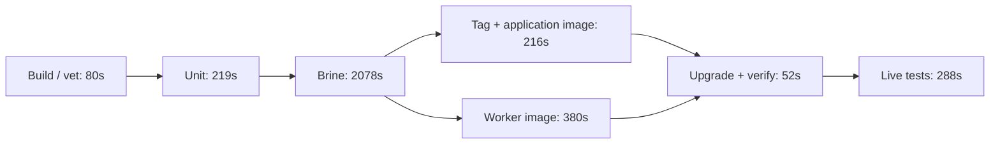

# CI test performance review — 2026-11-02

Core was fast-forwarded from `d2fbd85155` to
`1d0e377594898bff615f1c222f9977e0ea094acc`, the fetched `origin/core` head.
All new test executions in this review use that source snapshot. The review
changes documentation and profiling artifacts; it does not change production
code, test selection, assertions, timeout values, or installed pipelines.

## What matters most

The latest completed automatic main-pipeline chain took **51m37s**. **Brine
accounted for 34m38s, or 67.1%**. A worker-image build added a further **2m44s
of waiting after the application image was ready**. Unit tests took 3m39s.
Optimizing individual unit assertions alone cannot substantially shorten this
pipeline. These are observed timings on this exact core revision, not sums of
overlapping job durations. [Build-by-build evidence](ci-history-analysis.md)

The separate behavioral suite is already about **21 minutes**, rather than the
roughly 40 minutes suggested by older runs and its console banner. Historical
builds 211–218 have a 1,276s successful-run median. Their revisions and test
inventories differ; the old and new cohorts must not be pooled. The fresh
current-core Ginkgo invocation took **20m11s**, reporting all 296 declared
specs: **293 passed, two skipped, one failed twice**. The failing
spec expects an acyclic resource-type chain to be rejected, while the current
validator permits it. Both attempts created the pipeline successfully; this
is a test-expectation mismatch, not an observed timing failure.
Only its runner builder triggers on every core change; downstream tests trigger
on the eligible daily timer or a manual run. They do not gate the main release.

The most concrete unit optimization is repeated authentication setup:
the isolated integration profile spends **23.67 CPU-seconds generating ID-token
RSA keys** and **6.85 CPU-seconds hashing fixture passwords**. It is also the
package that finishes last in the full unit job. However, speeding up that
package alone exposes only **8.154s** of job-tail saving before chart tests
become the next bottleneck. Fixing that fixture work is better supported than
simply adding test workers. [Profiles and exact callers](ci-unit-profiles.md)

## Where the automatic main-pipeline time goes

| Contribution to elapsed path | Time | Share |
|---|---:|---:|
| Build and vet | 1m20s | 2.6% |
| Unit tests, including fly integration | 3m39s | 7.1% |
| Brine: native, local, live, cross-node, coverage | 34m38s | 67.1% |
| RC tag and application image | 3m36s | 7.0% |
| Additional worker-image wait | 2m44s | 5.3% |
| Upgrade and verification | 52s | 1.7% |
| Live tests after upgrade | 4m48s | 9.3% |
| **Total** | **51m37s** | **100%** |

Percentages are rounded. This path starts with build-and-vet and ends with
live tests; it excludes unmeasured commit-to-build queueing and the separately
triggered release. The full worker-image job takes 6m20s, but 3m36s overlaps
the tag/application-image path. Counting both full durations would overstate
elapsed time. The measurements are 2026-11-02 16:28:07–17:19:44 UTC.

The arrows into upgrade describe the observed effective ordering, including
serial-group exclusion; they are not all explicit artifact dependencies.
[Pipeline dependency and lock audit](ci-suite-structure.md)

## Fresh profiling and what it establishes

The evidence directory is
[`output/ci-performance-20261102`](../../output/ci-performance-20261102).
It contains raw CI events, source/image receipts, timing reports, resource
samples, **56 CPU/allocation/block/mutex profiles**, and offline analysis
scripts. A [portable evidence bundle](../../output/ci-performance-20261102/evidence.tar.gz)
and [file checksums](../../output/ci-performance-20261102/evidence-manifest.json)
retain the reports and data together.

| Execution | Evidence and scope |
|---|---|
| Full unit topology, build 1142547 | Unit command 204.319s; fly command 9.379s. All test commands pass. Eight heavy-suite timing reports and 32 merged Go profiles, foreground Go test JSON, fly report, and cgroup/process samples retained. CI's subsequent artifact export errors; files were independently copied before pod cleanup. |
| Five foreground packages, build 1142575 | All pass. 20 more profiles plus per-test JSON; integration and GC also have Ginkgo hook timings. Sequential execution is for diagnosis, not an A/B throughput comparison. |
| Normal Brine job 122, build 1142537 | Passed in 2,194s, including 918 local +131 live +one cross-node scenario, 5,687 steps and 1,050 complete recorder drains. Production statement coverage is 79.209574%, above the unchanged 50% gate. |
| Behavioral one-off, build 1142600 | Two K3s clusters and workers; 293 passed, two skipped, one failed after two attempts. Four merged profiles and full reports retained. Memory request is 18,000,000,000 bytes versus the normal 19,327,352,832; neither has a memory limit, and placement is the same 28-core node. |

The first unit profiling attempt is excluded from timing conclusions: it
overlapped other heavy one-off tasks and Ginkgo could not move profile binaries
between input and output filesystems. The corrected run retained its profiles
on the input filesystem. Its test success and subsequent CI export error are
separate facts. [Diagnostics](../../output/ci-performance-20261102/unit-export-diagnostics.log)

### Unit job: late scheduling and repeated work

The full unit job briefly has **187 compiler processes**, averages **17.25 CPU
cores**, and reaches **10.0 GiB sampled cgroup memory**. Its request is six CPUs,
with no CPU or memory limit; no CPU throttling was observed. Requests reserve
scheduling capacity and are not execution caps.
[Kubernetes resource semantics](https://kubernetes.io/docs/concepts/configuration/manage-resources-containers/)

`atc/integration` does not start its test execution until **159.612s** after
the unit command starts. It then takes **44.342s**, finishing last. DB's 1,315
Ginkgo specs take 94.386s, but its CLI takes 183.54s; DB finishes roughly 13.8s
before integration. The difference between a CLI duration and Ginkgo's suite
duration includes compilation, process startup and ordinary Go tests, so it
cannot all be labeled compilation.

Eight independent heavy-suite commands each launch four Ginkgo workers while
the foreground `go test` command also schedules packages. Ordinary `TestXxx`
functions in mixed Ginkgo packages execute in every worker and are absent from
Ginkgo's spec report. Runtime retry tests prescribe 16 seconds of sleeps per
binary, repeated four times. This is redundant aggregate work, not 64 seconds
of removable pipeline wall time. DB workers are already balanced within
0.152s, and the long algorithm regression fixture is off the final job path.
[Complete unit analysis](ci-unit-profiles.md)

### Brine and behavioral attribution

Fresh complete timing tables and validation receipts are in
[Brine profiling](ci-brine-profiles.md) and
[behavioral profiling](ci-behavioral-profiles.md).

Fresh Brine used about **4m56s for startup/build/native/coverage preparation**,
**7m53s for local scenarios**, **22m43s for live scenarios**, and **one minute
for cross-node work and final verification**. Its live run contains 1,244.370s
in steps, 97.527s in recorder cleanup and 20.500s in other scope/runner work.
The slowest individual step takes 94.425s to exercise real watch-history
expiration; Kubernetes v1.34.3's upstream default retains 75s of history.
Three real eviction steps take 52.662–73.374s, consistent with the nodes'
one-minute volume-statistics interval. These are authentic cluster behaviors,
not all removable test sleeps. [Source and measurement details](ci-brine-profiles.md)

Behavioral startup loads eight images into each isolated K3s cluster under a
shared lock. Each worker spends about **55–56s loading images**; the profiles
attribute **55.39 CPU-seconds and 2.37GB of cumulative allocations** to image
loading across both workers. Most of that CPU is re-tarring and gzip-compressing
local image archives before import. This gives a concrete setup optimization:
stream local archives and reuse exports while preserving the existing lock.
Final worker imbalance is only **1.926s**, so redistributing the last few specs
has little potential. [Setup and profile attribution](ci-behavioral-profiles.md)

Brine's protocol distinguishes steps, scenario duration, recorder disposal,
and overall run time. Recorder disposal is already included in scenario
duration; adding both double-counts it. Scope setup/disposal is partly outside
scenario timers. CPU samples from the adapter do not represent the live
Kubernetes pods it creates. Likewise, nested K3s containers run outside the
outer behavioral task cgroup; outer-pod metrics alone undercount that tier.
[Timer definitions and source inspection](ci-history-analysis.md#what-the-brine-jsonl-timers-actually-include)

## Changes to pursue, in order

These are measured opportunities and proposed experiments, not claimed
speedups. Keep test identities, outcomes, coverage union and cleanup proofs
constant when evaluating each change.

| Priority | Change | Evidence / potential | Required validation |
|---|---|---|---|
| 1 | Split Brine build/native/local work from the live-exclusive task; consider running local and live tiers concurrently after shared compilation. | Brine dominates the path. The fresh local run alone takes 473.131s. That is a roughly 7m53s overlap opportunity, **before** extra startup, contention and coverage merging; it is not a guaranteed saving. | Both manifests and cross-node participation must pass; merge source-matched coverage and preserve its gate. Retain live-cluster exclusion and namespace/storage cleanup. |
| 2 | Remove worker-image's avoidable post-image tail by scheduling its build outside the entire Brine exclusion window. | Latest path waits another 164s after the application image is ready. This is a 0–164s opportunity on that timeline, conditional on resource capacity. | Keep worker/app compatibility and upgrade gates; measure Brine interference and node memory before changing locks. |
| 3 | Reuse valid production-strength ID-token keys and supported prehashed passwords in ordinary integration fixtures. | Isolated profile: 23.67s CPU in the 4096-bit signing-key lifecycle; 6.85s in generating password hashes. Actual password verification remains necessary. Optimizing this package alone removes at most the observed 8.154s tail before chart tests become limiting. | Preserve empty-key, rotation and key-generation tests; retain bcrypt cost and real login verification. Do not reduce production cryptographic strength. |
| 4 | Give compilation one shared concurrency budget, start long foreground packages earlier, and trial a persistent Go build cache. | 187 observed compiler processes; integration starts at +159.6s. There is no explicit task Go compilation cache. | Repeated baseline/candidate runs on the same node/toolchain, cold and warm cache separated; retain `-count=1`. Cache retention is required because hostPath caches are not reclaimed today. |
| 5 | Fix whole-task retry amplification and split reusable passing stages from retryable live work. | Brine 119 finished green only after 4,104s; a 2,024s failed first attempt repeated all passing local work. | Diagnose the actual missing producing-pod failure. Preserve first-attempt failures in reports; a retry is not a substitute for fixing it. Behavioral already retries individual specs. |
| 6 | Publish the E2E toolchain on dependency changes, with immutable image identity and selected-source inputs. | Every source change currently causes a no-cache runner rebuild; historical successful median 284s. The Docker build clones moving core again. | Tests must still use the selected current checkout. Measure the E2E gate separately from its 21-minute suite; invalidate tools on relevant dependency changes. |
| 7 | Optimize proven fixture overhead and remove duplicate ordinary-test execution. | Integration/GC hook profiles and runtime retry-sleep multiplicity identify work. Algorithm fixture import uses more CPU than its actual algorithm. | Separate native and Ginkgo test selection without losing tests. Change test clocks only where real elapsed time is not the behavior under test. |
| 8 | End behavioral event reads at the SSE end marker, and replace fixed readiness sleeps with observed readiness. | Two event tests wait on a 30s HTTP deadline after completion; two hijack tests sleep 10s each and a container-list test sleeps 5s. These are aggregate opportunities across two workers, not additive job-wall savings. | Keep authenticated responses, expected events and completion assertions; require actual target-container/hijack success. Retain the unrelated chain-validation failure in results until corrected. |
| 9 | Stream behavioral image imports, reuse immutable exported archives and remove temporary archives after import. | Each worker loads images for 55–56s; loading accounts for 78.48% of sampled test-process CPU and 82.73% of allocations. | Retain exact image identity, isolated clusters and the setup lock that protects containerd. Measure export, transfer and import separately; do not equate aggregate CPU with suite wall saving. |

The two pipeline-overlap opportunities are more consequential than shaving
seconds from individual unit assertions. Increasing live concurrency or
removing cleanup checks is not supported by these measurements. Local Brine
and live Brine have different isolation requirements; treat that separation
as the first concurrency experiment.

## Profiling to keep in CI

Publish the source SHA, runner digest, toolchain versions, node, resource
requests/limits, seed and retry count alongside every result. Record shell
phase timestamps, `go test -json`, Ginkgo reports, Brine protocol JSONL and
first-attempt verdicts. Retain them on failure as well as success. The current
successful Brine console output hides the detailed local/live breakdown.

Use CPU/allocation profiles periodically and block/mutex profiles for focused
investigations; collecting all simultaneously can perturb timings. CPU
profiles show active CPU, not time waiting on database, Kubernetes or timers.
Profile child processes or their cgroups separately. Cumulative blocking time
can exceed wall time because many goroutines wait concurrently.
[Go diagnostics](https://go.dev/doc/diagnostics)

Measure end-to-end elapsed time and CPU-seconds independently. Compare
baseline/candidate in alternating order on matched hardware and source,
including at least three repetitions and failure/retry counts. A cache trial
must distinguish compilation caching from test-result caching; `-count=1`
retains actual execution. Go's build cache validates source and build inputs,
but C-library changes need explicit invalidation.
[Go cache documentation](https://go.dev/cmd/go/?m=old)

## Limits of the review

The historical sample has 320 build records and 68 complete event streams;
not every record has a downloaded source revision. Fresh profiles were taken
on a shared cluster, with overlap between profiling workloads. They explain
work and waiting, but do not establish a controlled speedup. Historical
unprofiled current-core runs supply the production baseline. No historical
commit-to-queue latency, complete distributed trace, or CPU profile of every
external Kubernetes service is claimed. The remaining scope-level Brine
residual needs named resource acquisition/disposal timers to split exactly.
All profiling task pods and this run's Brine namespaces were removed;
an unrelated namespace created October 31 was left untouched.
[Cleanup receipt](../../output/ci-performance-20261102/cleanup-verification.json)

Supporting reports:

- [Pipeline structure, inventory, locks and build duplication](ci-suite-structure.md)
- [Historical cohorts, critical path, failures and retry cost](ci-history-analysis.md)
- [Unit CPU, allocation, blocking, hooks and concurrency](ci-unit-profiles.md)
- [Fresh Brine step/scenario/cleanup attribution](ci-brine-profiles.md)
- [Fresh behavioral setup, specs, workers and nested resources](ci-behavioral-profiles.md)
